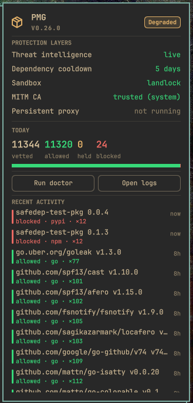
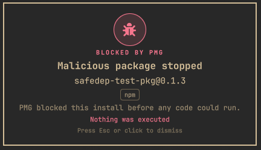

# PMG for Omarchy

[](https://github.com/safedep/pmg-omarchy/actions/workflows/ci.yml)

A native [Omarchy](https://omarchy.org) (Quattro) bar plugin for
[PMG](https://github.com/safedep/pmg), SafeDep's install-time package firewall.

<div align="center">
<table>
  <tr>
    <td align="center" valign="top">
      <br>
      <sub>The panel: protection layers, today's tally, and live activity.</sub>
    </td>
    <td align="center" valign="top">
      <br>
      <sub>The alert the moment PMG blocks a malicious install.</sub>
    </td>
  </tr>
</table>
</div>

The plugin only shows information. It reads what PMG exposes: `pmg setup info
--json` for health and layers, and PMG's event log for activity. It has no
security logic of its own.

## Requirements

- Omarchy 4.x ("Quattro") with the Quickshell plugin system.
- [PMG](https://github.com/safedep/pmg) **0.26+** installed and on `PATH`, with
  shell integration set up:

  ```bash
  pmg setup install
  ```

  (The `--json` status surface this plugin polls landed in PMG 0.26.)

## Install

```bash
omarchy plugin add https://github.com/safedep/pmg-omarchy.git --enable
```

Move it to a different bar section if you like:

```bash
omarchy bar move io.github.safedep.pmg --section right
```

## Settings

Configure via Omarchy's plugin settings (`omarchy plugin` UI) or the bar config:

| Setting | Default | Meaning |
| --- | --- | --- |
| `refreshIntervalSec` | 30 | How often to poll `pmg setup info --json`. |
| `feedLimit` | 12 | Rows shown in the activity feed. |
| `showOverlay` | On | Show the fullscreen alert on a block. |
| `notifyOnBlock` | On | Send a desktop notification on a block. |

## Update

Plugins are not updated automatically. Pull the latest version manually:

```bash
omarchy plugin update io.github.safedep.pmg
```

Omarchy fetches the changes, re-validates the plugin, and reloads the shell (it
rolls back automatically if the new version fails validation).

## Remove

```bash
omarchy plugin remove io.github.safedep.pmg
```

## License

Apache-2.0. See [LICENSE](LICENSE).
